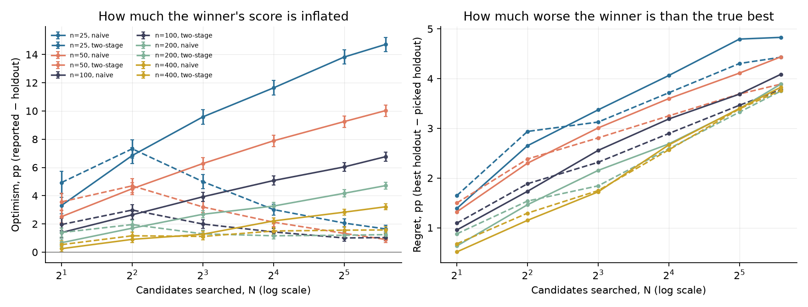
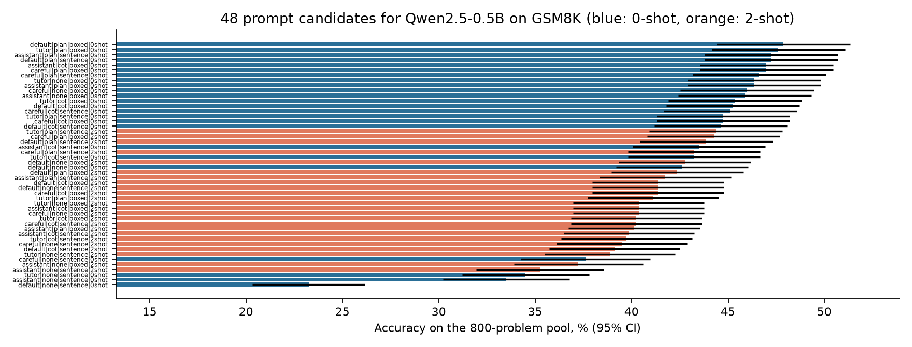

# prompt-selection-gap

**Automated prompt and agent search picks the candidate that scored best on a fixed set of tasks.
How inflated is the winner's score, how much worse is it than the truly best candidate — and does a
smarter selection protocol fix this at the same compute?**

A pilot on 48 prompts for Qwen2.5-0.5B-Instruct, each run on the same 800 GSM8K problems
(38 400 generations on a Kaggle T4), followed by 1000 simulated search-and-select runs.

## TL;DR

- **Prompts matter a lot.** The same model scores from 23.2% to 47.9% depending only on the prompt
  (median 42.7%). Asking it to plan before solving helps (+5.6 pp on average over no instruction);
  two worked examples *hurt* this small model (−2.7 pp).
- **The winner's score is badly inflated.** Picking the best of 48 prompts on a 50-problem search
  set reports **55.1%** while the winner really scores **45.1%** on held-out problems — a
  **10.0 pp** optimism. With 25 problems the gap is 14.7 pp; even 400 problems leave 3.2 pp.
- **Optimism grows with the number of candidates and shrinks with the search-set size** — and
  evolutionary agent design sits at the bad end of both, scoring thousands of candidates on a few
  dozen tasks.
- **A two-stage protocol fixes most of it at equal budget.** Screen all candidates on half the
  budget, re-evaluate the top 3 on fresh problems with the rest: at n = 50, N = 48 optimism drops
  from 10.0 to **0.9 pp** and the picked prompt is no worse (45.6% vs 45.1% held-out). It does *not*
  help when there are only 2–4 candidates.



## Setup

- **Candidates:** full factorial of 4 system prompts × 3 reasoning instructions (none / "think step
  by step" / "list the knowns, solve, verify") × 2 answer formats (`\boxed{}` / "The answer is:") ×
  {0, 2} worked examples from GSM8K train = 48 prompts ([`src/selgap/prompts.py`](src/selgap/prompts.py)).
- **Generation:** greedy, up to 512 new tokens; every prompt on the same 800 GSM8K test problems
  → a 48 × 800 correctness matrix. Answers parsed from the last `\boxed{}`, else the last number.
- **Simulation:** each run holds out 300 random problems; the search set is drawn from the other
  500. For every search-set size *n* ∈ {25, 50, 100, 200, 400} and number of candidates
  *N* ∈ {2, …, 48}, a random subset of *N* prompts is searched; 1000 runs per cell.
- **Protocols at an equal budget of N·n evaluations:**
  - **naive** — pick the best on *n* problems and report that score;
  - **two-stage** — all *N* on *n*/2 problems, the top 3 on fresh problems with the remaining
    budget, pick and report from stage two.
- **Metrics:** optimism = reported − held-out accuracy of the pick; regret = best held-out
  accuracy among the *N* searched − held-out accuracy of the pick.
- **Predictions were fixed before the data** ([PLAN.md](PLAN.md)).

## Results

### Prompt sensitivity



| Factor | Levels (mean accuracy) |
|---|---|
| Reasoning instruction | none 39.1% · step by step 42.6% · plan-solve-verify **44.7%** |
| Worked examples | **0-shot 43.5%** · 2-shot 40.8% |
| Answer format | **`\boxed{}` 43.5%** · "The answer is:" 40.8% |
| System prompt | 41.5–43.0%, small effect |

The worst prompt (no system prompt, no reasoning instruction, "The answer is:") makes the model
answer immediately without reasoning — 23.2%.

### Selection gap (n = 50 problems, N = 48 prompts)

| Protocol | Reported | Held-out of pick | Optimism | Regret |
|---|---|---|---|---|
| Naive | 55.1% | 45.1% | **10.0 pp** | 4.4 pp |
| Two-stage (same budget) | 46.5% | 45.6% | **0.9 pp** | 3.9 pp |

Full grid with 95% CIs: [`results/selection_summary.csv`](results/selection_summary.csv).

### Against the predictions

| Prediction (fixed in advance) | Outcome |
|---|---|
| Optimism grows with N, falls with n; > 3 pp at n = 50, N = 48 | ✅ 10.0 pp |
| Two-stage has lower optimism than naive for all n ≥ 50 | ⚠️ Only for N ≥ 8; with 2–4 candidates it is higher |
| Spread of true accuracy across prompts ≥ 5 pp | ✅ 24.6 pp (14.4 pp without the worst prompt) |

## What this suggests for automated agent design

1. A search loop that reports its best candidate's score on the search set will overstate it by
   several points even with hundreds of evaluation tasks — the number to trust is a fresh re-test.
2. Spending part of the evaluation budget on re-testing a short list is nearly free and removes
   most of the inflation; it does not cost quality of the pick.
3. Regret barely depends on the protocol: with these effect sizes no protocol reliably finds the
   truly best prompt from a few dozen tasks — the honest report matters more than the pick.

## Limitations

One small model, one benchmark, prompts from a hand-designed grid rather than an LLM-driven search
(real searches propose correlated, adaptively chosen candidates, which should make optimism
worse). Accuracy differences between the top prompts are within their confidence intervals.

## Reproduce

```bash
uv sync --extra gpu
uv run pytest
uv run python scripts/analyze.py <generation_dir_a> <generation_dir_b>
```

Generation runs as two Kaggle kernels ([`kaggle/runner.py`](kaggle/runner.py) with
[`configs/full_a.json`](configs/full_a.json) and [`configs/full_b.json`](configs/full_b.json)).
